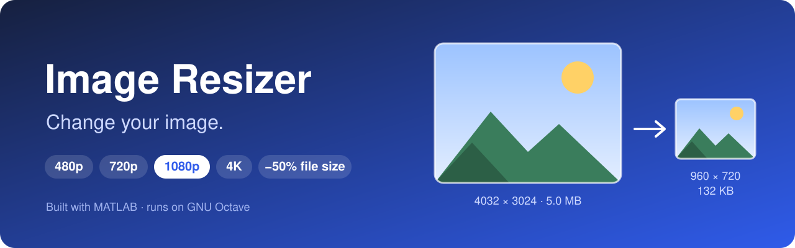

# Image Resizer



**Live demo:** https://image-resize-hwbp.onrender.com

A website for changing an image's resolution or shrinking its file size. The image processing is written in **MATLAB** and runs on **GNU Octave**, a free MATLAB-compatible engine, so the site can be hosted for free.

> The site runs on a free server. If nobody has used it for a while, the first load can take about a minute while it wakes up. Each image then takes about 5–30 seconds.

## Features

- **Change resolution:** 480p, 720p, 1080p, 1440p or 4K. The shorter side becomes the chosen size and the image keeps its shape (no cropping, no stretching).
- **Reduce file size:** by 20%, 50%, 75% or any percentage from 1 to 95. Width and height stay the same, and the image is saved as a JPG at the highest quality that meets the target.
- Before/after comparison of dimensions and file size, then one-click download
- Supports JPG and PNG up to 10 MB, including transparent and palette PNGs
- Works on phones and computers, with light and dark mode
- Privacy: images are deleted as soon as the result is sent back

## How it works

```
Browser (static/)  ->  Flask server (app.py)  ->  Octave runs matlab/process_image.m  ->  image sent back
```

1. The web page uploads the image and the chosen option to the server.
2. The server runs the MATLAB function `process_image` in GNU Octave.
3. **Resolution:** `imresize` with bicubic interpolation, one colour channel at a time to keep memory use low.
   **File size:** a binary search over JPG quality (1–100) finds the highest quality that fits the target size.
4. The result is sent back and the temporary files are deleted.

## Project structure

| Path | Description |
|---|---|
| `matlab/process_image.m` | The image processing (MATLAB / Octave) |
| `app.py` | Python Flask web server that calls the MATLAB code |
| `static/` | The web page (HTML, CSS, JavaScript) |
| `Dockerfile` | Installs Octave and runs the server, used for deployment |
| `.github/workflows/keep-awake.yml` | Pings the live site so the free server doesn't fall asleep |
| `docs/banner.svg` | The image at the top of this README |

## Use the MATLAB code directly

From the project folder in MATLAB (needs the Image Processing Toolbox) or Octave (`pkg load image`):

```matlab
addpath matlab
process_image('photo.jpg', 'photo_1080p.jpg', 'resolution', 1080)
process_image('photo.jpg', 'photo_small.jpg', 'filesize', 50)
```

## Run the website locally

**With MATLAB (Windows):**

```powershell
pip install flask
$env:IMAGE_ENGINE = "matlab"
$env:MATLAB_EXE = "C:\Program Files\MATLAB\R2026b\bin\matlab.exe"
python app.py
```

Then open http://localhost:7860. MATLAB starts up for every image, so each one takes 10–60 seconds locally.

**With Docker (same setup as the live site):**

```bash
docker build -t image-resizer .
docker run -p 7860:7860 image-resizer
```

## Deployment

The live site is hosted on [Render](https://render.com)'s free plan as a Docker web service connected to this repository. Every push to `main` rebuilds and redeploys it automatically.

The free plan sleeps after 15 minutes without visitors. The GitHub Actions workflow in `.github/workflows/keep-awake.yml` visits the site every 10 minutes to keep it awake.

## Limitations

- The free server has 512 MB of memory and a small share of a CPU, so very large images (over about 20 megapixels) may fail and processing is slower than on a PC.
- Reducing the file size always produces a JPG. Some images can't be made as small as requested without lowering the resolution, and the site says so when that happens.

## Built with

MATLAB · GNU Octave · Python (Flask) · HTML, CSS and JavaScript · Docker · Render
